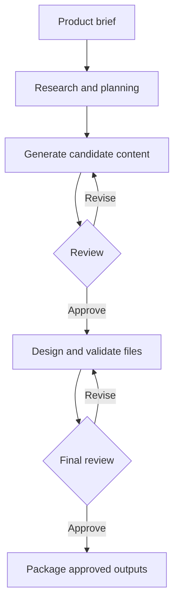

# Venge
### AI-Powered Digital Product Development
**Built by Miangelisse Encarnacion**  
AI Engineering · Full-Stack Systems · Workflow Orchestration

Venge brings research, product planning, content creation, design, review, and delivery into a coordinated product development workflow.

This public repository presents the product's engineering approach and a guided workflow. The commercial application and proprietary implementation remain private.

## The Problem
Creating a usable digital product takes more than generating text. Research needs supporting evidence, content needs structure, revisions need to preserve prior work, and exported files need to match what was reviewed.

I built the original product builder across its full engineering lifecycle: requirements, application development, AI integrations, workflow implementation, testing, debugging, deployment, and infrastructure.

## Explore the Project
- **[Architecture](architecture.md):** The responsibilities of the interface, API, AI providers, persistence, and validation.
- **[Guided Product Workflow](walkthrough.md):** An illustrative journey through generation, revision, review, and delivery.
- **[Technical Case Study](https://github.com/miangelisse-ux/engineering-case-studies/blob/main/case-studies/venge.md):** Engineering decisions, reliability, deployment approach, and limitations.

## Engineering Highlights
- **Staged AI workflows:** Coordinate model-assisted work through explicit application rules and review boundaries.
- **Structured outputs:** Check generated artifacts before treating them as usable results.
- **Versioned work:** Preserve saved artifacts and tie review decisions to the reviewed versions.
- **Human approval:** Separate generated assessments from explicit acceptance.
- **Format-specific validation:** Inspect generated files against approved content and relevant format requirements.
- **Full-stack delivery:** Connect the operator interface, API, persistence, generation, and output handling.

## Technology
| Layer | Technologies |
| --- | --- |
| Operator application | Next.js, React, TypeScript |
| API and workflow services | Node.js, HTTP APIs |
| Persistence | PostgreSQL |
| AI integrations | OpenAI and Google Vertex transport support |
| Deployment approach | Render |
| Quality | Workflow, persistence, provider-boundary, and export-validation test definitions |

Provider support describes the inspected implementation; it does not certify which provider is currently active in the hosted product.

## Workflow at a Glance

This is a conceptual overview, not a disclosure of internal routing or prompt logic.

## Validation and Status
The implementation contains workflow-gate, persistence, provider-boundary, and generated-file validation tests. Export checks include reopening artifacts and comparing their content with reviewed versions.

Portfolio preparation reviewed source and recorded documentation; it did not rerun every test, certify every delivery format, or independently verify the current hosted environment. Test counts, revenue, performance benchmarks, and blanket production-readiness claims are deliberately omitted.

## Repository Scope
This repository contains presentation documentation only. It does not contain the product's source code, prompts, configuration, credentials, database contents, generated customer products, or a runnable application.

The walkthrough uses a fictional example. It is not a customer record, recorded product demonstration, or claim of a newly executed generation run.

## Connect
[LinkedIn — Miangelisse Encarnacion](https://www.linkedin.com/in/miangelisse-encarnacion/) · [Engineering Portfolio](https://github.com/miangelisse-ux/engineering-case-studies)
