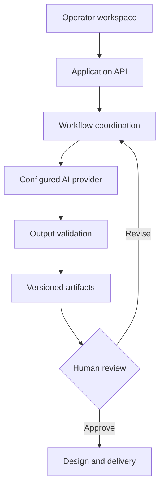

# Venge — Architecture
[Back to overview](README.md)

Venge separates the operator experience, application-controlled workflow, model-provider requests, saved artifacts, and output checks. This page explains those boundaries at a high level.

## System Overview

## Responsibilities
| Component | Responsibility |
| --- | --- |
| Next.js interface | Present work, edits, progress, review decisions, and next actions |
| Node API | Handle application requests and connect workflow operations to persistence |
| Workflow coordination | Apply dependencies and permitted transitions |
| Provider transport | Request model-assisted generation or assessment |
| PostgreSQL persistence | Save versioned artifacts and review decisions |
| Validation | Check structured outputs and relevant exported-file behavior |
| Human review | Accept or request changes to the reviewed output |

## Application Rules and Model Work
The application determines whether a workflow operation is allowed. A model produces a candidate artifact or assessment within that operation. A model-generated review does not grant human approval.

Saved versions matter because later edits must not silently inherit the acceptance of a different output. Format checks matter because valid prose does not establish a usable spreadsheet or presentation.

## Reliability Considerations
- Validate incomplete or malformed provider output.
- Keep saved artifacts and review decisions distinguishable.
- Preserve prior work during revisions.
- Check output files against the reviewed content.
- Distinguish source-supported capabilities from current hosted acceptance.

Tests and validation definitions exist in the private implementation. This public repository contains no executable tests or production configuration, and this documentation does not claim a fresh test run.

## Deployment
The documented deployment approach uses Render, a Next.js operator application, a Node hosting/API layer, and PostgreSQL persistence. Current deployment parity, provider configuration, and hosted readiness require separate verification.

Internal schemas, detailed routing, proprietary thresholds, prompts, and operational settings are excluded.
